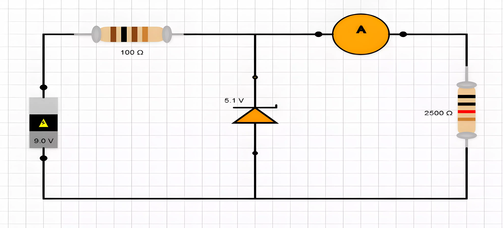
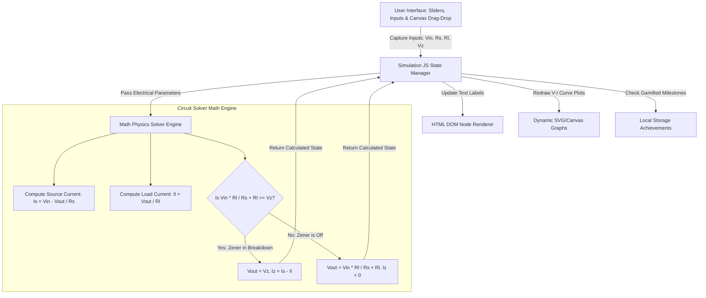

# 🔬 Zener Diode Virtual Lab

<div align="center">

[](https://github.com/FrostByte-49/Zener_Diode_Simulation/stargazers)
[](https://github.com/FrostByte-49/Zener_Diode_Simulation/blob/main/LICENSE)
[](https://github.com/FrostByte-49/Zener_Diode_Simulation)
[](https://github.com/FrostByte-49/Zener_Diode_Simulation)
[](https://github.com/FrostByte-49/Zener_Diode_Simulation/commits/main)
[](https://github.com/FrostByte-49/Zener_Diode_Simulation/issues)
[](https://github.com/FrostByte-49/Zener_Diode_Simulation/pulls)
</div>

The Zener Diode Simulation platform is an interactive, browser-based educational sandbox designed to help electrical engineering students, educators, and hobbyists master the behavior of Zener diodes in voltage regulation circuits. In physical electronics laboratories, grasping the abstract concepts of breakdown voltage, knee currents, load regulation, and line regulation can be highly challenging due to invisible electrical currents and risk of component damage. This project addresses those challenges directly by offering a safe, real-time, drag-and-drop circuit simulator that visually demystifies how a Zener diode stabilizes output voltage despite fluctuating source inputs or load resistances.

Technically, the project is structured as a modular, lightweight single-page and multi-page web application compiled with HTML5, CSS3 transitions, and vanilla JavaScript mathematical solvers. Instead of relying on heavy circuit-simulator wrappers, it leverages custom mathematical state machines that execute the real-time node voltages and branch currents of a standard voltage regulator network in milliseconds. Accompanied by integrated gamified challenges (such as debug modes, speed typing, memory games, and rapid-fire quizzes) alongside a persistent user statistics dashboard, this tool bridges the gap between static textbook diagrams and dynamic laboratory experiment systems.

<br>

## 📑 Table of Contents
- [Features](#-features)
- [Preview](#-preview)
- [Technologies Used](#-technologies-used)
- [System Architecture](#-system-architecture)
- [Project Structure](#-project-structure)
- [Getting Started](#-getting-started)
- [Usage](#-usage)
- [API Reference](#-api-reference)
- [Customization](#-customization)
- [Future Enhancements](#-future-enhancements)
- [How To Contribute](#-how-to-contribute)
- [License](#-license)
- [Author](#-author)
- [Support The Project](#-support-the-project)

<br>

## ✨ Features

- **Interactive Drag-and-Drop Circuit Design Sandbox**: Build voltage regulator circuits dynamically, dragging key electronic elements into place to construct a fully closed circuit loop.
- **Real-Time Mathematical Solver Engine**: Compute instant node equations for source resistance voltage drops, load voltage outputs, source current, load current, and critical Zener branch current based on mathematical parameters.
- **Dynamic Voltage Regulation Curves**: Graphically render real-time V-I characteristics and load/line regulation curves using responsive SVG or canvas plotters, reflecting changes immediately when parameter sliders shift.
- **Comprehensive User Dashboard & State Tracking**: Monitor student learning achievements, test results, challenge scores, and physical simulation metrics locally or through the browser state.
- **Gamified Interactive Challenges**: Enhance learning retention using built-in interactive modules including debug mode, rapid-fire conceptual testing, typing speed evaluation for electronics vocabulary, and memorization trials.
- **Polished Multipage Navigation Flow**: Seamlessly explore specialized dedicated views for Theory, structured Lab Procedures, Sandbox Simulations, and Team About bios with consistent styles.
- **Built-In User Authentication Simulation**: Implement complete HTML5/JS authentication views encompassing login, registration, and credential recovery mechanisms to demonstrate practical app deployment paths.

<br>

## 🖼️ Preview

| **Concept & Simulation Sandbox** |
|---|
|  |

<br>

## 🛠️ Technologies Used

| Technology | Purpose |
| --- | --- |
| **HTML5** | Establishes semantic document structure, viewport settings, and embedded media elements for the simulation workbench. |
| **CSS3** | Powers application aesthetics, responsive layout flows (using Flexbox and Grid), preloader visual animations, and interactive component state transitions. |
| **Vanilla JavaScript (ES6+)** | Drives the core physical simulation math engine, handles UI drag-and-drop state machines, dynamically updates graph renders, and runs logical games. |
| **Google Tag / Analytics** | Provides site telemetry, mapping student interaction metrics and tracking popular simulation paths to optimize interface layout. |
| **Local Storage / Session State** | Handles client-side persistent variables representing simulated session credentials, game score states, and lab challenge completions. |

<br>

## 🏗️ System Architecture

The following diagram details the interaction sequence when a developer or student engages with the circuit simulation sandbox. It outlines how user UI inputs trigger the underlying mathematical solver to re-compute circuit physics and update the visual graphics:



<br>

## 📂 Project Structure

This directory structure details the physical layout of the repository. It highlights the separation of visual presentation layouts, challenge games, core physics scripts, page views, and static web assets:

```bash
.
├── .gitattributes                                    # Git configuration path attribute settings
├── README.md                                         # Project documentation manual
├── about.html                                        # About section details and project developers list
├── index.html                                        # Home landing page configuration and access paths
├── procedure.html                                    # Guided laboratory instruction manual view
├── simulation.css                                    # Custom styles for the interactive drag-drop interface
├── simulation.html                                   # Layout of the main interactive Zener simulation dashboard
├── simulation.js                                     # Mathematics, state changes, and rendering for the simulator
├── sketch_.html                                      # Auxiliary experimental test-bench interface
├── style.css                                         # Global visual layout variables, fonts, and base overrides
├── theory.html                                       # Detailed theoretical guide for Zener physical properties
│
├── 📁Loader_/                                        # Dynamic sub-system directories
│   │
│   ├── 📁Challenges_/                                # Gamified reinforcement exercises directory
│   │   ├── debug.html                                # Interactive circuit debugging challenge
│   │   ├── memory.html                               # Memorization card challenge for electronics
│   │   ├── rapid_fire.html                           # Rapid question-and-answer timed interface
│   │   └── typ_speed.html                            # Educational typing metric reinforcement game
│   │
│   ├── 📁Dashboard_/                                 # Unified statistics tracking directory
│   │   ├── dashboard.css                             # Layout and visual grids for student analytics
│   │   ├── dashboard.html                            # Master panel for user challenge statistics
│   │   ├── dashboard.js                              # Main local statistics synchronization controller
│   │   ├── dashboard_.js                             # Alternative visualization script for analytics
│   │   └── default.png                               # Fallback user avatar visualization
│   │
│   ├── 📁Login_/                                     # Mock user authorization workflow assets
│   │   ├── login.js                                  # Local authorization verification processor
│   │   ├── register.css                              # Registration module custom CSS designs
│   │   ├── register.html                             # User registration input module layout
│   │   ├── register.js                               # Local account initialization scripting logic
│   │   └── reset.js                                  # Password recovery mock controller scripts
│   │
│   ├── 📁Preloader_/                                 # Splash loader modules for landing delays
│   │   ├── preloader.css                             # Animated physics load indicators style rules
│   │   ├── preloader.html                            # Dynamic nested frame loader rendering page
│   │   └── script.js                                 # Preloader redirection execution handler
│   │
│   └── 📁Testimonial_/                               # User review feedback component files
│       ├── 📁rev_img/                                # Compressed reviews image resources
│       │   ├── Review_1.webp                         # Testimonial thumbnail picture asset 1
│       │   ├── Review_2.webp                         # Testimonial thumbnail picture asset 2
│       │   ├── Review_3.webp                         # Testimonial thumbnail picture asset 3
│       │   ├── Review_4.webp                         # Testimonial thumbnail picture asset 4
│       │   ├── Review_5.webp                         # Testimonial thumbnail picture asset 5
│       │   ├── Review_6.jpg                          # Testimonial thumbnail picture asset 6
│       │   ├── Review_7.jpg                          # Testimonial thumbnail picture asset 7
│       │   ├── Review_8.webp                         # Testimonial thumbnail picture asset 8
│       │   ├── Review_9.jpg                          # Testimonial thumbnail picture asset 9
│       │   ├── t32.png                               # Star ranking visual interface icon 1
│       │   └── t33.png                               # Star ranking visual interface icon 2
│       ├── testimonial.css                           # Card styling and slider responsive adjustments
│       ├── testimonial.html                          # Standalone feedback review board container
│       └── testimonial.js                            # Interactive script for feedback carousels
│
├── 📁Team_/                                          # Project team bio visual directories
│   ├── 1.png                                         # Organization brand representation visual 1
│   ├── 2.png                                         # Organization brand representation visual 2
│   ├── 📁Images_/                                    # Dynamic layout branding files
│   │   └── Team_1.webp                               # Assembled project team photography visual
│   ├── Logo_.webp                                    # Vector-based application logo asset
│   └── 📁Pics/                                       # Individual developer portfolio photography
│       ├── Akif_.webp                                # Software Developer contributor portrait
│       ├── Hujaifa_.webp                             # UI/UX Designer contributor portrait
│       ├── Krishna_.webp                             # QA Tester contributor portrait
│       ├── Manasi_.webp                              # Project Manager contributor portrait
│       ├── Neeta_Ma'am_.webp                         # Project Faculty Advisory portrait
│       ├── Pranav_.webp                              # System Architect contributor portrait
│       ├── Soham_.webp                               # Simulation Math Developer portrait
│       └── Swayam_.webp                              # Content Coordinator portrait
│
└── 📁zner_img/                                       # Physics theory media resources
    ├── Picture_1.webp                                # Equivalent circuit of Zener Diode
    ├── Picture_10.webp                               # VI Characteristics curve chart diagram
    ├── Picture_11.webp                               # Zener Breakdown mechanism schematic
    ├── Picture_12.webp                               # Reverse recovery profile image
    ├── Picture_13.webp                               # Dynamic resistance visual parameter
    ├── Picture_14.webp                               # High load regulation visual sample
    ├── Picture_15.webp                               # Output performance reference profile
    ├── Picture_16.webp                               # Zener application favicon component
    ├── Picture_17.webp                               # Typical test connection arrangement layout
    ├── Picture_18.webp                               # Forward conduction threshold graph
    ├── Picture_19.webp                               # Mathematical loop formula image representation
    ├── Picture_2.webp                                # Semiconductor doping density visual guide
    ├── Picture_20.webp                               # Load regulation circuit schematic diagrams
    ├── Picture_21.webp                               # Line regulation circuit schematic diagrams
    ├── Picture_3.webp                                # Depletion region width visual diagram
    ├── Picture_4.webp                                # Electric field intensity visual graph
    ├── Picture_5.webp                                # Avalanche multiplication effect diagram
    ├── Picture_6.webp                                # Zener Tunneling effect structural graphic
    ├── Picture_7.webp                                # Multi-temperature drift curve charts
    ├── Picture_8.webp                                # Standard diode circuit configuration layout
    ├── Picture_9.webp                                # Zener Diode schematic symbol reference
    └── Zener_Animation.mp4                           # MP4 animated visualization of electron behavior
```

<br>

## 🚀 Getting Started

Follow these step-by-step instructions to configure, run, and develop the Zener Diode Simulation platform locally on your development machine.

### 1. Environment and Configuration Setup

Since the application is a client-side frontend simulator, it runs directly inside standard web browsers. However, to support modular file fetching and dynamic preloader frames without encountering CORS limitations during local development, running the code through a local HTTP server is highly recommended.

Make sure you have Node.js installed to use its simple live-reloading servers.

Create an optional `.env` file in your root folder if you plan to link any custom visual tracking hooks (such as Google Analytics IDs):

```bash
# Local Development Variable overrides (optional)
ANALYTICS_ID=G-xxxxxxxxxx
DEV_PORT=3000
```

#

### 2. Install Project Dependencies

The project uses a lightweight development configuration. Install the required Node modules to support local file hosting, asset optimization, and live-reload serving.

```bash
# Clone the repository
git clone https://github.com/FrostByte-49/Zener_Diode_Simulation.git

# Navigate into the project folder
cd Zener_Diode_Simulation
```

#

### 3. Start the Local Server

Run the development command to initialize a local HTTP server. This serves the workspace files correctly, enabling you to inspect interactive changes in real time.

```bash
# Run the local development server
```

After executing this command, open your browser and navigate to `http://localhost:3000` (or the port specified in your console outputs) to interact with the Zener Diode Simulator.

<br>

## ▶️ Usage

This section demonstrates how to leverage the core features of the Zener Diode Simulation platform.

### Feature 1: Simulating Voltage Regulation Under Load

To evaluate how a Zener diode maintains constant output voltage, you can execute the calculation math inside the sandbox. In the web interface, drag the slide bars to adjust parameters like source voltage ($V_{in}$) or load resistance ($R_l$). 

You can also simulate these parameters programmatically using the following circuit math configuration:

```javascript
// Example programmatic usage of the core math calculation found in simulation.js
import { calculateZenerState } from './simulation.js';

const circuitParameters = {
  vin: 12.0,   // Input unregulated DC voltage in Volts
  rs: 220,     // Series limiting resistor value in Ohms
  rl: 1000,    // Load resistor value in Ohms
  vz: 5.1      // Nominal Zener breakdown voltage in Volts
};

const output = calculateZenerState(circuitParameters);

console.log(`Unregulated voltage drop: ${output.vLoadUnregulated} V`);
console.log(`Actual Load Output Voltage: ${output.vLoad} V`);
console.log(`Current passing through Zener: ${output.iZener} mA`);
console.log(`Is system actively regulating? ${output.isRegulating}`);
```
#

### Feature 2: Running Interactive Quiz Challenges

Students can run electronic memory games or concept quizzes dynamically. Each challenge updates the user's dashboard progress. You can load specific challenge parameters using standard web methods:

```javascript
// Initialize typing training speed metrics in Challenges sub-module
import { initializeTypingChallenge } from './Loader_/Challenges_/typ_speed.js';

const challengeSettings = {
  timeLimit: 60,                // Timed test duration in seconds
  vocabularyTier: 'intermediate' // Vocabulary level (basic, intermediate, advanced)
};

// Start the evaluation engine
initializeTypingChallenge(challengeSettings);
```

<br>

## 🔌 API Reference

The Zener Diode Simulation platform exposes JS-based functional application interfaces used by controllers to manage calculations, dashboard values, and state preservation.

### Client-Side Engine Route Map

| Method / Call | Interface Endpoint / Hook | Description | Auth Required |
| --- | --- | --- | --- |
| `GET` | Local Storage: `user_session_state` | Retrieves the logged-in student's active session data. | No |
| `POST` | Programmatic UI Hook: `calculateZenerState` | Computes load regulation metrics based on inputs. | No |
| `POST` | Local Storage: `saveChallengeProgress` | Persists a student's high score for completed challenges. | Yes |
| `POST` | Core Handler: `resetUserScore` | Resets all saved records for active lab metrics. | Yes |

#

### 1) Computational Call: calculateZenerState

This function computes the active electrical properties of the Zener diode voltage regulation network.

- **Execution Hook**: `calculateZenerState(parameters)`
- **Request Parameters**:

```json
{
  "vin": 15.0,
  "rs": 100.0,
  "rl": 500.0,
  "vz": 6.2
}
```

- **Output Response (Returned JavaScript Object)**:

```json
{
  "vLoadUnregulated": 12.5,
  "vLoad": 6.2,
  "iSource": 0.088,
  "iLoad": 0.0124,
  "iZener": 0.0756,
  "isRegulating": true,
  "mode": "breakdown"
}
```

- **Operational Note**: If `vLoadUnregulated` is lower than the Zener breakdown threshold (`vz`), the diode acts as an open circuit. Under these conditions, the output voltage is calculated using a standard voltage divider formula: $V_{out} = V_{in} \times \frac{R_l}{R_s + R_l}$.

#

### 2) Storage Setter: saveChallengeProgress

Saves dynamic quiz results and typing statistics to local storage for the analytical dashboard views.

- **Execution Hook**: `saveChallengeProgress(scorePayload)`
- **Request Parameters**:

```json
{
  "username": "student_johndoe",
  "challengeType": "rapid_fire",
  "score": 95,
  "timeElapsed": "00:45",
  "completedAt": "2023-11-04T12:00:00.000Z"
}
```

- **Output Response (Returned JavaScript Object)**:

```json
{
  "status": "success",
  "storedRecords": 1,
  "message": "Challenge metric synchronized successfully."
}
```

<br>

## ⚙️ Customization

You can easily configure or extend the simulation platform to support custom academic environments:

- **Adding Custom Zener Models**: Extend the parameters lookup table inside `simulation.js` to include standard real-world commercial diodes (e.g., 1N4733A for 5.1V or 1N4735A for 6.2V).
- **Modifying the Canvas Visuals**: Modify the drawing styles in `simulation.css` to adjust color themes, switch line path rendering colors, or alter graphical grid properties.
- **Integrating Custom API Backends**: Swap out browser local storage components with fetch operations in `dashboard.js` to persist student grades in an LMS (Learning Management System) like Canvas or Moodle.
- **Customizing Quiz Content**: Expand the conceptual questions stored in `Loader_/Challenges_/rapid_fire.html` to test students on wider semiconductor physics subjects.
- **Altering the Doping & Physics Animation Speed**: Modify key parameters inside `zner_img/Zener_Animation.mp4` or swap the path with dynamic canvas scripts to illustrate high-voltage electron tunneling and avalanche breakdowns at different speeds.

<br>

## 🔮 Future Enhancements

- **Full SPICE Engine Support**: Replace vanilla calculations with an integrated, lightweight SPICE engine to model parasitic resistance, internal temperature drift, and dynamic AC ripple suppression.
- **Dynamic Waveform Visualizer**: Add an interactive virtual oscilloscope interface to visualize input and output AC-to-DC ripple curves in real time.
- **Broad Component Support**: Expand the component palette to allow custom assemblies with multi-stage diode cascades, bipolar junction transistors (BJTs), and operational amplifiers.
- **Cloud-Synced Gradebooks**: Introduce real-time student tracking by connecting user accounts to an external Postgres or MongoDB backend.
- **Interactive PDF Report Generator**: Allow students to export customized, verified lab results, including calculated graphs and answers to challenge questions, directly as a PDF report.
- **Fully Interactive Multi-Language Support**: Implement localization pathways to translate instructions and technical terminology into Spanish, French, Hindi, and Mandarin.

<br>

## 🤝 How To Contribute

We welcome community feedback, feature proposals, and optimizations from educators and student developers.

#### 1. Fork the Repository
Create your own copy of the repository on GitHub by clicking the "Fork" button in the upper-right corner.

#

#### 2. Create a Topic Branch
Isolate your development progress in a descriptive feature branch:
```bash
git checkout -b feature/dynamic-oscilloscope-display
```

#

#### 3. Commit Your Changes
Make clean, focused commits with helpful messages:
```bash
git commit -m "feat: integrate dynamic real-time oscilloscope visualizer canvas"
```

#

#### 4. Push and Open a Pull Request
Push your branch to your remote repository and open a Pull Request for review:
```bash
git push origin feature/dynamic-oscilloscope-display
```

#

### Areas For Contribution
- **Mathematical Refinement**: Optimize calculating models for edge-case resistor scenarios (e.g., handling open/short circuits smoothly).
- **UI/UX Optimization**: Help optimize responsiveness for mobile viewports and touch interactions during drag-and-drop operations.
- **Accessibility Improvements**: Implement keyboard controls and Screen Reader compatibility for vision-impaired students.

<br>

## 📜 License

This project is licensed under the MIT License. See the [LICENSE](https://github.com/FrostByte-49/Zener_Diode_Simulation/blob/main/LICENSE) file for details.

<br>

## 👤 Author

**1) Krishna Choudhary**<br>
**2) Pranav Khalate**<br>

<br>

## 📬 Contact Us

Have a question, suggestion, or just want to say hi? Reach out!

* 📧 Email:

  * Krishna Choudhary: [c.krishna.santosh@gmail.com](mailto:c.krishna.santosh@gmail.com)
  * Pranav Khalate: [pranav.kh25@gmail.com](mailto:pranav.kh25@gmail.com)

* 📷 Instagram: [@team.quantum.squad](https://www.instagram.com/team.quantum.squad)

<br>

## 🔗 Useful Links

* 🌐 **Website**: [zenersim.netlify.app](https://zenersim.netlify.app)
* 📱 **App Access**: [rb.gy/0aigtz](https://rb.gy/0aigtz)

<br>

## 🌟 Support The Project

If the Zener Diode Simulation platform helped you understand semiconductor physics or simplified your electronics lab work, please consider starring and sharing the repository!

<br>

<!-- Minimal Documentation Badge -->
<p align="right">
  <a href="https://trywharf.vercel.app/" target="_blank">
    
  </a>
</p>
